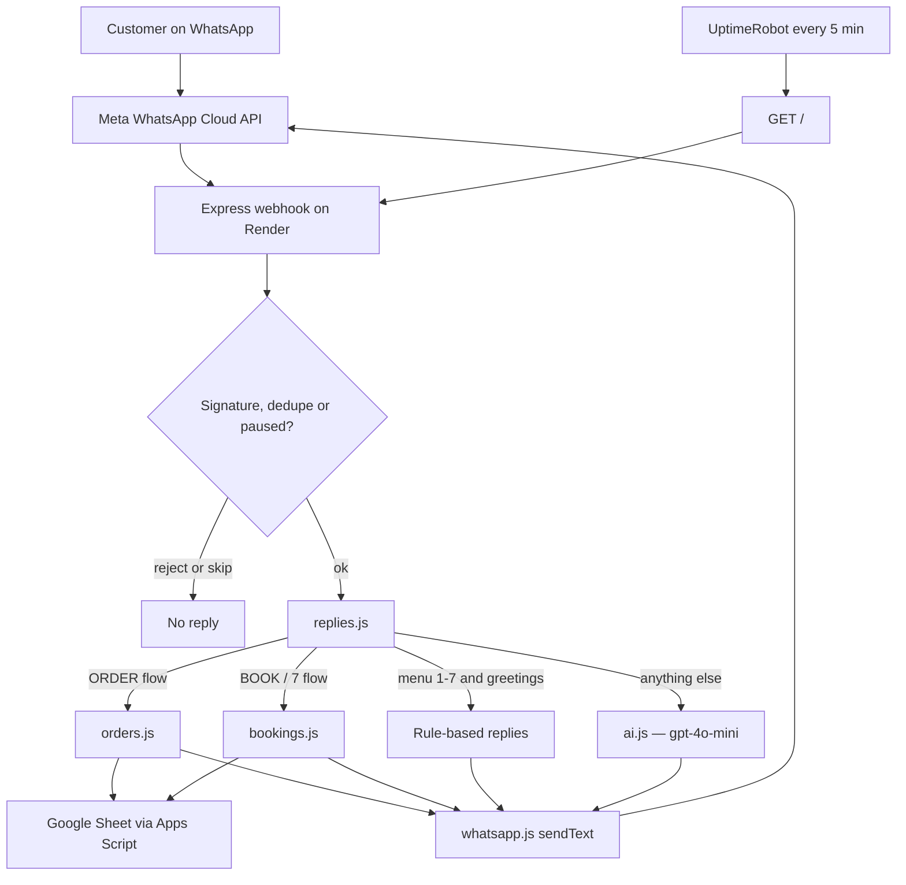

# WHOIAM WhatsApp bot

A WhatsApp assistant for WHOIAM in Hull that takes orders and catering bookings, chats in English, Pidgin or Yoruba, and holds the conversation when Blessing cannot be on the phone.

Built for WHOIAM — Blessing's bakery, confectionery, Nigerian food and catering business. Slogan: *Made with Love, Served with Excellence*.

Repository: [github.com/aboladvisuals/wa-bot](https://github.com/aboladvisuals/wa-bot)

## Features

- Numbered menu (1–7): cakes and cupcakes, Nigerian food, small chops, delivery and collection, how to order and pay, talk to Blessing, catering and events
- Step-by-step orders (`ORDER`): item, date, collection or delivery, postcode, name. Issues a `WHO-####` reference, shares the Revolut link and asks for a payment screenshot
- Catering and event bookings (`BOOK`, `catering`, `event`, or `7`): event type, date, guests, food, venue, name. Issues an `EVT-####` reference; Blessing follows up with a quote
- `CANCEL` stops an order or booking mid-flow
- Warm, short WhatsApp-style AI replies for everything the rules do not already handle, with per-number memory of the last 10 messages. Mirrors English, Pidgin or Yoruba. Never invents prices, dates or bank details
- Orders and bookings are saved to a Google Sheet
- Image messages are treated as payment screenshots and acknowledged
- Blessing can type `#me` in a chat to pause the bot, and `#bot` to resume
- Hosted on Render's free tier and kept awake by UptimeRobot pinging `GET /` every five minutes

## Architecture

Prices, the menu, order and booking flows, and payment details live in rule-based code so the AI can never make them up. The model only handles conversation that the rules do not match, and hands off to Blessing for payment confirmation, complaints or custom quotes.



## Tech stack

| Layer | Choice |
| --- | --- |
| Runtime | Node.js, Express, ES modules |
| Messaging | Meta WhatsApp Cloud API |
| Conversation fallback | OpenAI `gpt-4o-mini` (official `openai` SDK) |
| Storage | Google Sheet, via an Apps Script web app (`doPost` + shared secret) |
| Hosting | Render free tier, kept awake by UptimeRobot |

The project first used Google Gemini. It was switched to OpenAI after free-tier 503s and 404s, and because the tone felt stiff.

## Setup

The working copy on the development PC is `C:\dev\wa-bot`.

### 1. Clone and install

```bash
git clone https://github.com/aboladvisuals/wa-bot.git
cd wa-bot
npm install
```

Start locally with `node index.js` (there is no `npm start` script). The server listens on `process.env.PORT` or 3000.

### 2. Environment variables

Copy the list below into a `.env` file in the project root. Put the same keys in the Render dashboard for production. **Never commit real values.** `.env` is already in `.gitignore`.

```env
VERIFY_TOKEN=your-webhook-verify-token
WHATSAPP_TOKEN=your-whatsapp-access-token
PHONE_NUMBER_ID=your-phone-number-id
APP_SECRET=your-meta-app-secret
OPENAI_API_KEY=your-openai-api-key
OPENAI_MODEL=gpt-4o-mini
REVOLUT_LINK=https://revolut.me/your-handle
SHEET_URL=https://script.google.com/macros/s/your-deployment-id/exec
SHEET_SECRET=your-long-random-string
```

`OPENAI_MODEL` is optional; if it is omitted the bot uses `gpt-4o-mini`.

### 3. Meta webhook

1. In the Meta Developer Console, add the WhatsApp product to your app.
2. Set the webhook callback URL to `https://<your-service>.onrender.com/webhook`, and use the same verify token as `VERIFY_TOKEN`.
3. Subscribe to `messages`. For `#me` / `#bot` pause and resume, also subscribe to `smb_message_echoes`.
4. Copy the phone number ID, access token and app secret into `.env` and Render.

The webhook verifies `GET /webhook` with `VERIFY_TOKEN`, and checks `POST /webhook` with an `X-Hub-Signature-256` HMAC of the raw body using `APP_SECRET`.

### 4. Google Sheet and Apps Script

1. Create a Google Sheet (for example, `WHOIAM Orders`) with this header row:

   `Time | Ref | Phone | Name | Item | Date | Method | Postcode | Status`

2. Open **Extensions → Apps Script**, replace the stub with the script below, and save.

```javascript
function doPost(e) {
  const data = JSON.parse(e.postData.contents);
  if (data.secret !== PropertiesService.getScriptProperties().getProperty("SECRET")) {
    return ContentService.createTextOutput("unauthorised");
  }
  SpreadsheetApp.getActiveSpreadsheet().getSheets()[0].appendRow([
    new Date(), data.ref, data.phone, data.name, data.item, data.date, data.method, data.postcode, data.status || "Awaiting payment"
  ]);
  return ContentService.createTextOutput("ok");
}
```

3. In **Project Settings → Script properties**, add `SECRET` with the same long random string as `SHEET_SECRET`.
4. **Deploy → New deployment → Web app**. Set *Execute as* to **Me** and *Who has access* to **Anyone**, then authorise. Copy the web app URL (it ends in `/exec`) into `SHEET_URL`.
5. After any script change, deploy a **New version**. The URL stays the same.

If Google shows an “unverified app” warning during authorisation, that is expected for a script you own: use **Advanced**, then continue and allow access.

### 5. Render and UptimeRobot

1. Create a Render web service from this GitHub repository.
2. Set the start command to `node index.js`.
3. Add every environment variable from the list above in the Render dashboard. Do not put secrets in the repo.
4. In UptimeRobot, add an HTTP monitor that pings `GET https://<your-service>.onrender.com/` every five minutes, so the free tier does not spin down.

## Project structure

```
wa-bot/
├── index.js        # Webhook (GET verify, POST /webhook), HMAC check, dedupe, #me/#bot, image handling
├── whatsapp.js     # Sends text replies via the Cloud API
├── replies.js      # Menu 1–7, friendly chat rules, routes to orders, bookings or AI
├── orders.js       # Order flow, WHO-#### refs, Sheet write, Revolut link
├── bookings.js     # Event flow, EVT-#### refs, Sheet write
├── ai.js           # OpenAI fallback, system prompt, last-10 memory
├── sheet.js        # POSTs records to SHEET_URL with SHEET_SECRET
├── business.js     # Menu, prices, delivery copy, Revolut link
├── package.json
└── .gitignore      # Ignores node_modules and .env
```

## Security notes

- Incoming webhooks are verified with `X-Hub-Signature-256`: an HMAC-SHA256 of the raw body, compared with `crypto.timingSafeEqual`.
- Message IDs are stored in a Set and ignored on retry, so Meta does not trigger a double reply.
- Sheet writes require `SHEET_SECRET`. The web app URL is not a secret, but it should still stay out of the repository and live in `.env` and Render only.
- All secrets belong in `.env` and the Render dashboard. Never commit them.
- The AI is not allowed to invent prices, discounts, dates, availability or bank details. Those come from `business.js` and the order/booking flows.

## Roadmap

The bot currently runs on a test number. Putting it on Blessing's real WhatsApp Business number (Coexistence, so she can still use the phone app) needs AboladLabs to become a Meta Tech Provider; business verification is pending.

Known limits:

- A Yoruba message is sometimes answered in Pidgin
- Order and booking sessions are held in memory, so a restart mid-flow resets them

Planned next:

- Automatic payment checks
- Owner alerts for new orders and bookings
- A multi-client, white-label version

## Author

Abolade (AboladLabs) — Hull-based data analyst, BI and full-stack developer.

- Website: [aboladlabs.com](https://aboladlabs.com)
- Email: [hello@aboladlabs.com](mailto:hello@aboladlabs.com)
